 

  

 

## About

I'm an informatics student with a strong passion for software development. I build practical applications with **Python and Django**, and I'm growing my skills in **React, Django REST Framework, and PostgreSQL**.

I care about clean architecture, solid APIs, and software that solves a real problem for real people, from loan portals to digital archives. My goal is to become a professional **Full-Stack Software Engineer**.

 

## What I Do

 

## Tech Stack

 

## Featured Projects

  

 

## GitHub Stats

 

## Roadmap

 

 

 

## Contact

### Let's build something great together.

 

