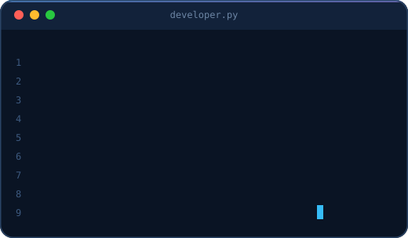
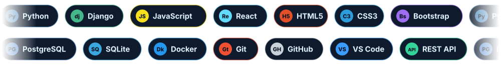
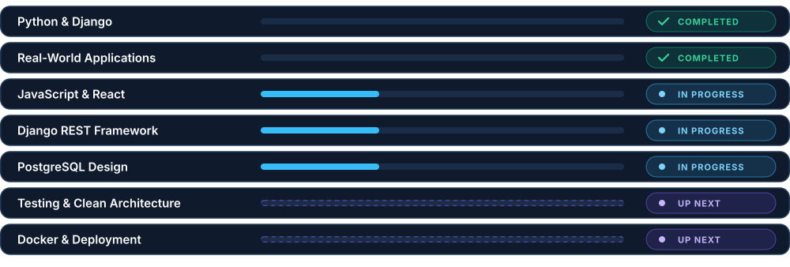
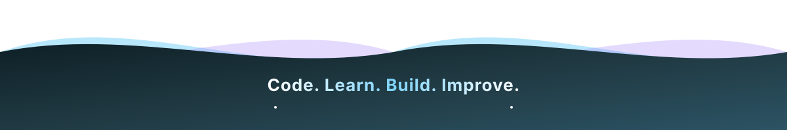

 

  

 

## About

<table>
<tr>
<td width="48%" valign="top">

I'm an informatics student with a strong passion for software development. I build practical applications with **Python and Django**, and I'm growing my skills in **React, Django REST Framework, and PostgreSQL**.

I care about clean architecture, solid APIs, and software that solves a real problem for real people, from loan portals to digital archives.

🎯 **Goal:** become a professional **Full-Stack Software Engineer**.

</td>
<td width="52%" valign="top" align="center">

</td>
</tr>
</table>

 

## What I Do

 

## Tech Stack

 

## Featured Projects

  

 

## GitHub Stats

 

## Roadmap

 

## Contact

### Let's build something great together.

